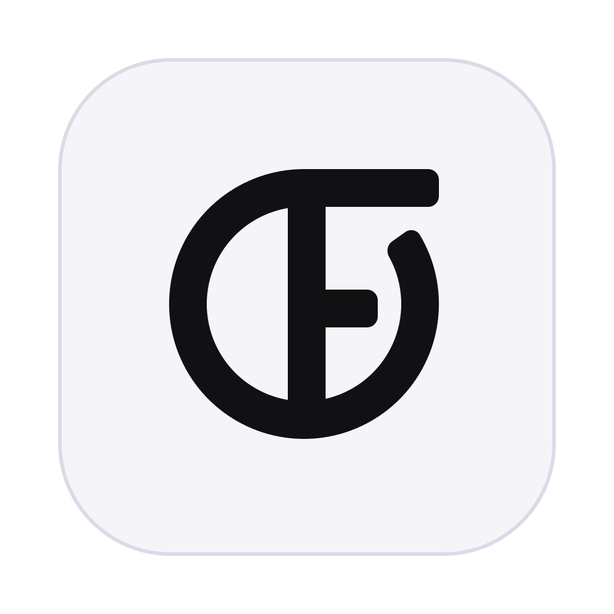

<div align="center">



# OpenFini

**A lightweight, open-source creative suite — Vector, Pixel, Layout, Code, Vibe and Office studios in one small app.**

[](https://github.com/philppplik/open-fini/actions/workflows/ci.yml)
[](LICENSE)


[Download](#install) · [Studios](#the-studios) · [Why it is light](#why-it-is-light) · [Build from source](#build-from-source) · [Docs](#documentation) · [Contributing](CONTRIBUTING.md)

</div>

OpenFini is a design and photo-editing suite built around **studios** — focused workspaces that share one document:

| Studio | For | Highlights |
| --- | --- | --- |
| **Vector** | Logos, icons, illustration, UI | Bézier pen, node editing, shapes, booleans, gradients, live effects, SVG import/export |
| **Pixel** | Photo editing and painting | Layers and masks, brushes, selections, retouching, live adjustments and filters, Develop and Liquify, a live histogram with interactive Levels and Curves |
| **Layout** | Brochures, books, print | Pages and master pages, text frames that flow across pages, styles, editable tables with formulas, linked charts, PDF import and export with bleed |
| **Code** | Websites | Code editor and visual designer over the same HTML / CSS / JS files: explorer, Emmet, live canvas with breakpoints, class-based style panel, 13 framework starters, Git, one-click publishing, Markdown and LaTeX, static-site export |
| **Vibe** | Describe it, an AI builds it | Chat assistant with 100 tools that works natively in every studio; bring your own model; skills, MCP, RAG, right-click AI. Off by default |
| **Office** | Word documents and letters | Open and edit `.docx`, ODT, RTF, HTML and Markdown, tables, images, styles, page layout; export DOCX and PDF (reached through the *More* menu) |

Switch studios at any time: a document can mix vector shapes, pixel layers, flowing text and a website project. **Export** is a button in the header (PNG / JPEG / WebP / SVG / PDF, slices, websites), not a studio of its own.

> **Status: alpha.** OpenFini is a real, working application, but it is young. Read [what is not there yet](docs/roadmap.md) before you plan production work around it. File format and APIs may still change.

> **Not affiliated with any commercial product.** OpenFini is an independent, clean-room implementation. It contains no code, assets, icons or file formats from other products. Product names mentioned anywhere are trademarks of their owners. See [docs/clean-room.md](docs/clean-room.md).

## Install

| Platform | Download | Notes |
| --- | --- | --- |
| Windows x64 / ARM64 | `OpenFini_x.y.z_x64-setup.exe` / `…_arm64-setup.exe` | Per-user installer, no admin rights needed |
| macOS Apple Silicon / Intel | `OpenFini_x.y.z_aarch64.dmg` / `…_x64.dmg` | Unsigned builds: right-click → Open the first time |
| Linux x64 / ARM64 | `.AppImage`, `.deb`, `.rpm` | Needs WebKitGTK 4.1 (preinstalled on most desktops) |
| Any browser (PWA) | <https://philppplik.github.io/open-fini/> | Installable, works offline, files stay on your device |

> **Heads-up:** the desktop installers are built by GitHub Actions on the first tagged release. The web app and all engines are tested locally; the installers themselves (especially Windows ARM64 and the macOS Intel cross-build) have not been run on hardware yet — see the status column in [docs/platform-support.md](docs/platform-support.md). Please report problems.

Installers are produced by the [release workflow](.github/workflows/release.yml) and listed on the [Releases](https://github.com/philppplik/open-fini/releases) page together with `SHA256SUMS.txt`. See [docs/platform-support.md](docs/platform-support.md) for the full support matrix and [docs/building.md](docs/building.md) for the unsigned-binary caveats.

## The studios

### Vector

- **Draw**: pen (click / drag Béziers), pencil with curve fitting, rectangle, ellipse, polygon, star, line and 17 preset shapes.
- **Edit**: node tool (move, convert, break, join, insert, delete; drag a segment to reshape), transform handles that work on rotated objects, snapping to guides / objects / grid / margins, rulers and guides, align and distribute.
- **Combine**: Add, Subtract, Intersect, Exclude and Divide; convert to curves; expand stroke; image trace.
- **Style**: solid, linear, radial and conical gradients on fills and strokes, stroke alignment / caps / joins / dashes, opacity and 16 blend modes, live effects (outer / inner shadow, outer / inner glow, outline, color overlay, Gaussian blur).
- **Type**: artistic text and frames with an in-canvas editor (IME aware), character and paragraph controls, your own font files.
- **Import / export**: SVG in and out, PNG / JPEG / WebP, PDF.

### Pixel

- **Layers**: pixel layers, groups, layer masks (paint on them or build them from selections), blend modes, nested or global adjustments.
- **Select**: rectangular / elliptical marquee, freehand and polygonal lasso, magic wand, color range; add / subtract / intersect, feather, grow, shrink, border, smooth, invert; selection to layer / mask / curves.
- **Paint**: brush with pressure, hardness, flow, spacing and stabilizer, pencil, eraser, paint bucket, gradients — all respect the selection.
- **Retouch**: clone stamp, healing brush, spot healing, red-eye removal, smudge, blur, sharpen, dodge, burn, sponge.
- **Adjust** (non-destructive layers): 18 adjustments (levels, curves, HSL, white balance, selective color, gradient map, …), 22 live filters (Gaussian / motion / radial / zoom blur, unsharp mask, clarity, noise, halftone, oil paint, tilt-shift, …), a RAW-style **Develop** pipeline and **Tone Mapping**; auto levels / contrast / color; live histogram.
- **Transform**: crop with ratios, resize and canvas size, **Liquify** (push, twirl, pinch, bloat, reconstruct), **Image Trace** to vectors.

### Layout

- **Pages**: add, duplicate, reorder, facing pages, bleed, margins and columns, guides.
- **Masters**: master pages with automatic page-number, page-count and date fields.
- **Text**: frames that **flow across pages** (link, unlink, flow into a new frame, autoflow), justification, hyphenation (US English), tabs with leaders, bullets and numbering, drop caps, widow / orphan control, paragraph and character styles, table of contents from heading styles.
- **Objects**: image frames (fill-crop on drop), tables, shapes and everything from the Vector studio.
- **Data merge**: load a CSV, preview each record in place, export one merged PDF.
- **Output**: PDF with embedded TrueType/OpenType fonts, bleed and crop marks.

### Code

- **Two ways of working on the same files.** A real code editor ([CodeMirror 6](https://codemirror.net)) with one tab and undo history per file, syntax highlighting for HTML / CSS / JavaScript / JSON / Markdown / SVG, completions that know your classes, custom properties and files, **Emmet** (`Tab`), find and replace across the project, a command palette (`Ctrl+Shift+P`) and quick open (`Ctrl+P`) — and a **visual designer** with a live canvas at desktop, tablet and mobile breakpoints.
- **Source-preserving.** The files are the only source of truth. Clicking, dragging, inserting and styling write minimal edits into your HTML and CSS (formatting and comments survive); typing in the editor updates the canvas instantly.
- **Class-based style panel**: layout (flex / grid), spacing, size, position, typography, backgrounds and gradients, borders, shadows, effects — per class and per breakpoint (`@media` blocks are written for you), with inherited values shown.
- **Navigator, Add panel, Assets, Console and Problems**; design pages of the same document can become SVG / PNG assets.
- **Templates** (landing page, portfolio, blog, documentation, link in bio) and **static-site export** (ZIP, single-file pages or a folder, minify, sitemap).
- The preview runs in a sandboxed frame that cannot touch the app. See the [Code studio guide](docs/code-studio.md).

### Vibe (AI)

- **Tell it what you want.** A chat like Claude Code or Cowork, with attachments, skills, memory and a plan view. The assistant uses OpenFini's own 100 tools: it draws shapes and text, adjusts photos, lays out pages and builds websites in the other studios, and every run can be undone in one click.
- **Not locked in.** Bring your own account: OpenRouter (with sign-in), OpenAI, Anthropic, DeepSeek, xAI (Grok), Mistral, Groq, Together, Gemini, local models (Ollama, LM Studio) or any OpenAI-compatible server. Keys stay on your device, optionally encrypted with a passphrase.
- **Modern AI plumbing.** Tool use with permission modes, MCP servers (plus a localhost gateway for stdio servers), RAG over your own documents, skills (`SKILL.md` style), custom tools the assistant can write, image generation and editing.
- **Right-click AI** in the canvas, the code editor and the website designer. **Off by default**: nothing is sent anywhere until you switch it on. An offline *Demo* assistant shows how it works without a key. See the [Vibe Studio guide](docs/vibe-studio.md).

### Export (popup)

The **Export** button in the header opens a popup from any studio: PNG / JPEG / WebP / SVG / PDF with scale, quality, bleed and crop marks; **slices** (draw them with the Slice tool or create them from layers, one file each or one ZIP); and, for documents with a website project, the **website**.

## Beyond the studios

- **Your files stay yours.** A file opened with *File ▸ Open* (`.txt`, `.md`, `.docx`, `.svg` …) is saved back in its own format with `Ctrl+S`; OpenFini only asks for `.ofini` when the document outgrows that format. Older `.ofini` files are upgraded when opened (see [docs/file-format.md](docs/file-format.md)), and quitting with unsaved documents shows one *Save All / Discard / Cancel* dialog.

- **Several windows, several chats.** Move any studio or document into its own window (*File ▸ New Window*, tab right-click). Vibe can run several chats at once, start sub-agents for focused tasks, and shows an *AI is …* status pill while it works. See [docs/multi-window.md](docs/multi-window.md) and [docs/vibe-studio.md](docs/vibe-studio.md).
- **Make it yours.** Rebind every shortcut, hide tools and menu items, save workspaces, pick which five studios the header shows, and share all of it as a profile. See [docs/customization.md](docs/customization.md).
- **German, automatically.** The interface follows your system language (Deutsch is complete for the main surfaces; more languages are a translation file away). See [docs/i18n.md](docs/i18n.md).
- **Right-click knows where you are**, including encode/decode tools for special characters in code.
- **Five bundled extensions** (not installed by default): Palette Pro, Batch Export, Data Filler, Code Tools and an Accessibility Checker. See [docs/bundled-extensions.md](docs/bundled-extensions.md).
- **Updates, your way.** *Settings ▸ About* can check for a new version; automatic checks are optional and off by default.

- **Extensions with an SDK.** Add commands, menu items, dock panels, themes, templates and Vibe tools with sandboxed `.ofext` extensions. Every extension declares permissions, runs in its own sandbox and is undoable. See [docs/extensions.md](docs/extensions.md) and the [`sdk/`](sdk) folder.
- **Themes.** Twelve themes, each with a light and a dark variant, plus accent colors, high contrast and thin themed scrollbars. See [docs/themes.md](docs/themes.md).
- **Guided, not guessed.** A welcome tour, a mini tour per studio, tooltips that explain, *What's this?* (`Shift+F1`), a global command palette (`Ctrl+K`) and a What's new page.
- **Open what you have.** PSD / PSB, IDML, PDF and Illustrator (`.ai` with PDF content) open as editable documents with an import report; Markdown, LaTeX and plain text open in the Code studio; folders open as projects; drop files anywhere; **Open with OpenFini** works from Windows, macOS and Linux (desktop) and the installed PWA. Affinity, InDesign, Figma and XD files are proprietary: OpenFini tells you how to export them to an open format. See [docs/file-compat.md](docs/file-compat.md) and [docs/os-integration.md](docs/os-integration.md).
- **Security and troubleshooting tools.** App lock (encrypts local data at rest), offline mode, safe mode, protected mode for untrusted projects, a stored-data inventory, redacted logs and a Troubleshooting dialog. See [docs/security.md](docs/security.md) and [docs/troubleshooting.md](docs/troubleshooting.md).

## Why it is light

OpenFini is designed for older and low-power devices as much as for workstations.

- **No framework, no bundled browser.** Plain ES modules and Canvas 2D (no WebGL needed), the [Shoelace](https://shoelace.style) design system loaded component-by-component. The desktop app is a [Tauri](https://tauri.app) shell around the operating system's WebView, so installers do not carry a copy of a browser (typically a few megabytes instead of the ~100 MB of Electron-style apps; exact installer sizes are published with each release).
- **Measured** (production build, Chromium, release candidate): DOMContentLoaded 83 ms, first contentful paint 208 ms, ~6 MB JavaScript heap at start-up, start-up needs only the core application JavaScript (the Code studio loads on demand). See [docs/performance.md](docs/performance.md) for method and more numbers.
- **Draws only what changed.** Display lists are cached per node; panning and zooming move a GPU-composited bitmap and re-render when the gesture settles; brush strokes recomposite only the 256×256 tiles they touched.
- **Low-power mode** (automatic on weak hardware): 1× rendering, no shadows, shorter undo history, no live-effect preview while dragging.
- **Everything stays on your device**: no accounts, no telemetry, no network calls after the app is installed (a website project's preview only loads what that project itself references). The one exception is opt-in: if you switch on AI features and connect a model, your requests go to the provider you chose — and only then.
- **The Code and Vibe studios cost nothing until you open them**: the editor (CodeMirror), the engines, the AI runtime and the panels are loaded lazily.

## Build from source

Requirements: Node.js 20+ and npm. (Rust is only needed for the desktop app.)

```bash
git clone https://github.com/philppplik/open-fini.git
cd OpenFini
npm install
npm start            # http://localhost:4173 — no build step, edit and reload
npm test             # unit tests
npm run build        # optimized PWA in dist/
npm run tauri:dev    # desktop app (needs Rust, see docs/building.md)
npm run tauri:build  # installers for your platform
```

The application itself has **no build step** in development: `app/` is served as-is. Production builds bundle and minify it with esbuild.

## Documentation

| | |
| --- | --- |
| [Architecture](docs/architecture.md) | Layers, data flow, display lists, performance design |
| [Studios guide](docs/studios.md) | Tools, panels and shortcuts per studio |
| [Code studio](docs/code-studio.md) · [Web engine](docs/web-engine.md) | Website workbench and its pure engine |
| [Vibe Studio](docs/vibe-studio.md) · [AI engine](docs/ai-engine.md) | The AI studio, providers, tools, MCP, RAG, skills |
| [Developer guide](docs/development.md) | **Start here if you want to contribute:** module map, recipes, testing, Git workflow |
| [Office studio](docs/office-studio.md) · [Customization](docs/customization.md) · [Context menus](docs/context-menus.md) · [Multi-window](docs/multi-window.md) · [i18n](docs/i18n.md) | Newer areas |
| [Extensions](docs/extensions.md) · [Themes](docs/themes.md) | Extension SDK, manifest and API; theme registry |
| [Frameworks](docs/frameworks.md) · [Git and publishing](docs/git-and-publishing.md) | Code studio frameworks, Markdown/LaTeX, Git, deploy targets |
| [Layout tables and charts](docs/layout-tables-charts.md) · [Pixel histogram](docs/pixel-histogram.md) · [PDF import](docs/pdf-import.md) | Studio features in depth |
| [Security](docs/security.md) · [Troubleshooting](docs/troubleshooting.md) · [OS integration](docs/os-integration.md) | Security tools, diagnostics, file associations |
| [File format](docs/file-format.md) | The `.ofini` container |
| [Design system](docs/design-system.md) | Shoelace, tokens, theming, icons |
| [Performance](docs/performance.md) | Measurements and low-power design |
| [Engine contracts](docs/engine-contracts.md) | Data shapes shared by the engines |
| [Testing](docs/testing.md) | Test suites, benchmarks, manual QA checklist |
| [Building](docs/building.md) · [Platform support](docs/platform-support.md) · [Release process](docs/release-process.md) | Packaging and CI/CD |
| [Roadmap](docs/roadmap.md) | Known gaps and plans |
| [Clean-room policy](docs/clean-room.md) | Legal and contribution hygiene |
| [Decision records](docs/adr) | Why Tauri, Canvas 2D, Shoelace, … |

## Contributing

Contributions are welcome — start with [CONTRIBUTING.md](CONTRIBUTING.md). By participating you agree to the [Code of Conduct](CODE_OF_CONDUCT.md). Please report security issues privately as described in [SECURITY.md](SECURITY.md).

## License

OpenFini is released under the [MIT License](LICENSE). Third-party components are listed in [THIRD_PARTY_NOTICES.md](THIRD_PARTY_NOTICES.md).
